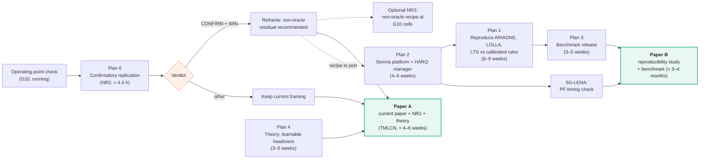
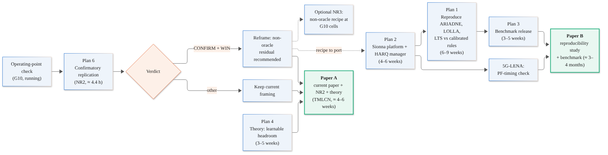
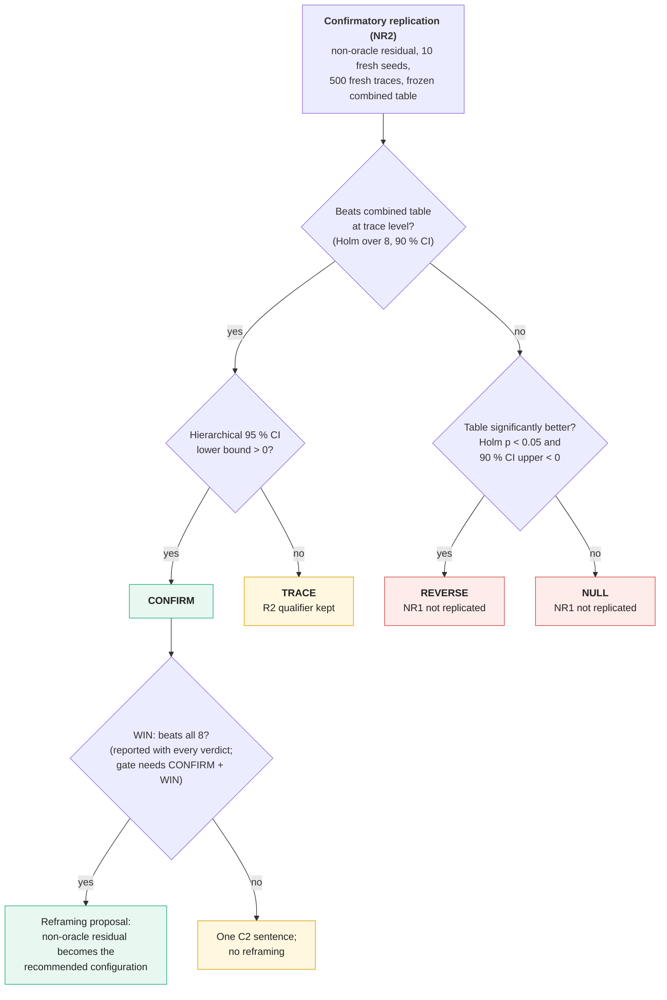
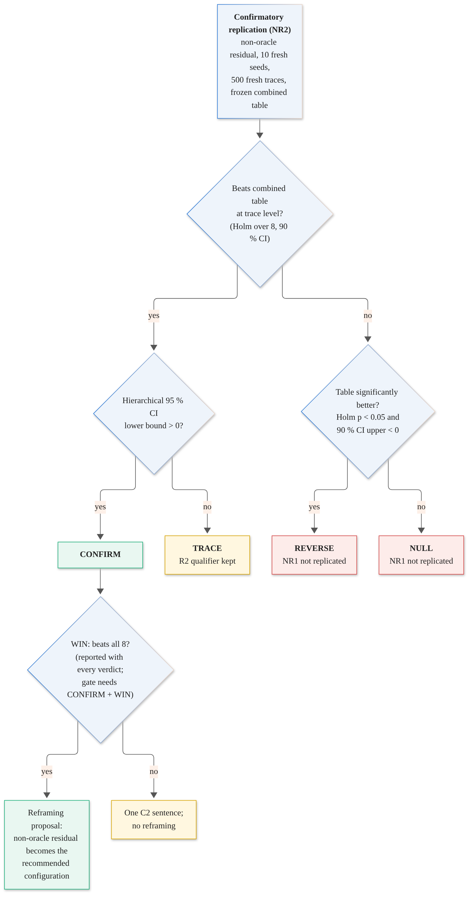

# Roadmap toward an award-level paper: plans 1, 2, 3, 4 and 6

**Date:** 8 Nov 2026 · **Status:** proposal (nothing here is frozen) · **Basis:** draft v3 (`paper/manuscript/draft_v3.pdf`), the award-paper comparison of 8 Nov, and the external facts checked the same day (sources at the end).

Every new experiment below follows the project's existing discipline: a pre-registration frozen by amendment **before** it runs, disjoint calibration / evaluation traces, common random numbers, ten seeds, trace-level and seed-level rules, and numbers read into the paper only through generated macros.

## 0. Summary and recommended order

| # | Plan | What it adds | Effort (one person) | Compute | Risk | Value |
|---|---|---|---|---|---|---|
| **6** | Let the confirmatory replication (NR2) decide the story | A positive, recommendable configuration — or an honest null | done (frozen); ≈ 1 day of follow-up | ≈ 4.4 h, already queued after G10 | low | high, and first |
| **4** | Theory: how much can any learner add over a table? | A value-of-information bound plus a measured "learnable headroom", turning the empirical finding into a predictive one | 3–5 weeks | small (≈ 1–3 h of instrumented evaluation) | medium (the bound may be loose) | high |
| **1** | Reproduce published learned LA schemes against calibrated rules | Turns the *inferred* comparator gap into a *demonstrated* one (the Ferrari Dacrema move) | 6–9 weeks (shares the platform with plan 2) | moderate; a GPU helps | medium–high (reproducibility, fairness) | **highest** |
| **2** | A second platform (Sionna SYS; 5G-LENA for one check) | Shows the findings are not artefacts of one MATLAB simulator or its SINR-to-BLER abstraction | 4–6 weeks | CPU feasible for stochastic channels | medium | high |
| **3** | Release a benchmark | Adoption and long-term impact: traces, calibrated baselines, statistics, per-run results | 3–5 weeks (+3–4 weeks for a Python port) | small | low | high (slow to pay off) |

**Recommended order:** 6 → 4 → (2 and 1 together, on one platform) → 3. Plan 6 is already queued. Plan 4 needs only the existing simulator. Plans 1 and 2 share the same new platform, so building it once serves both. Plan 3 packages what 1, 2 and 4 produce.

**Honest scope note.** Plans 1–3 together are a second paper's worth of work. The strongest strategy is probably **two papers**: Paper A (the present paper + NR2 + the theory of plan 4), submitted soon; Paper B (reproductions + second platform + benchmark), aimed at the impact the award judges reward. Section 6 discusses this.

---

### Dependency map

Source: `paper/figures_src/roadmap.mmd`.

## Plan 6 — Let the confirmatory replication decide the story

**Goal.** Test, on fresh traces and fresh seeds, whether the non-oracle residual policy beats the frozen combined table at trace level *and* seed level. Everything is already pre-registered (`paper/proposals/NR2_confirmatory_prereg.md`, Amendment 3, FREEZE v4); the PC runner implements it (`stage_nr2.m`, commit `d1f63fc`) and runs it after G10.

### 6.1 Timeline
- G10 was ≈ 32 h from 8 Nov morning, so it should finish around **9 Nov afternoon**; NR2 then needs ≈ 4.4 h (range 3.3–6.3 h).
- Analysis and the manuscript update take about one working day after that.

### 6.2 Run checklist (in order; stop at the first failure)
1. `cd paper/proposals && sha256sum -c FREEZE.sha256` — all OK.
2. Preflight file shows ≤ 0.96 s per episode (1.5 × the 0.64 s basis), or an explicit `APPROVE_nr2.txt`.
3. `check` unit: both table hashes match; base offset −2 in `ckpt/nr1/calib.mat` and `cal500_single.txt`; every trace, CRN, decision and seed range disjoint from earlier rounds.
4. `repro` unit: the eight comparators and the ten stored M1 policies reproduce on M1 traces 1–20 **bit-identically**.
5. Training and evaluation complete; `ckpt/nr2/eval.mat` contains **per-seed** arrays (10 × 500).
6. `python3 paper/analysis/nr2_stats.py` runs; MATLAB and python agree (margins and CIs to two decimals, p-values within 5 % relative).
7. Paste `nr2_pending_values.csv` into `pending_values.csv`; set `NR2,run`; add the registry rows (one case, up to three rows); rebuild; `check_pending.py` passes.

### 6.3 What happens for each verdict

| Verdict (frozen definitions) | Paper change | Follow-up |
|---|---|---|
| **CONFIRM + WIN** | Apply `NR2_reframing_proposal.md`: the non-oracle residual becomes the **recommended configuration**; M1 stays the pre-registered primary; abstract and C2 gain one sentence with the hierarchical CI | The non-oracle recipe is the configuration ported in plans 1–2 (pre-registered as such) |
| **CONFIRM, not WIN** | One C2 sentence; no reframing | Investigate which comparator was not beaten (descriptive only) |
| **TRACE** | Wording row inserted; the "not robust across seeds" message is strengthened (it now holds for two configurations) | Plan 4 becomes the main way to explain the result |
| **NULL / REVERSE** | NR1 reported as not replicated; the base-rule paragraph is shortened | The paper becomes a clean methodology-and-limits paper; plans 1 and 4 carry the impact |

### 6.4 Rules that must not be broken
- No re-run, re-seed or re-tuning after seeing NR2.
- No change to the comparator family or the decision rules.
- An error follows rule R6 (one retry, then halt).

### 6.5 One gap that stays open, whatever the verdict
G10 tested the oracle-or-selected base at the two neighbouring operating points, not the non-oracle recipe. If NR2 confirms, a small **NR3** (non-oracle recipe at the two G10 cells, ≈ 9 h) can be pre-registered *after* NR2, never before, and only if the authors want the recommendation to extend beyond the M1 point.

---

### NR2 verdict tree (as pre-registered)

Source: `paper/figures_src/nr2_verdicts.mmd`.

## Plan 4 — Theory: how much can any learner add over a table built on the same information?

**Goal.** Replace "the learner gained +0.66 % over the combined table, not robustly" with a statement that *predicts* when a learner can help. This is the Björnson–Sanguinetti move: a simple, exact statement of the condition under which the popular claim holds, tested against the numbers.

### 4.1 Set-up (one page in the paper)
- A decision is made for each scheduled new transmission. The gNB observes a feature vector $x$ (CQI history, slack, HARQ state, …). A **table** sees only a cell index $k = \phi(x)$ from a finite partition (slack bin × class × busy). A **learner** sees $x$. A **residual** learner is restricted to $a \in \{b(\phi_0(x)) - 1,\, b,\, b + 1\}$ around a base rule $b$.
- The objective $J(\pi)$ is the long-run on-time ratio (deadline traffic) or goodput.

### 4.2 Statements to prove (all short; mostly standard results, applied to this problem)
1. **Information ordering.** $\max_T J(T\circ\phi) \le \max_\pi J(\pi) \le J_\text{genie}$. The quantity $\Delta_\text{info} = J^*(x) - J^*(\phi)$ is the *most* any learner can add over the best table on the same cues. It is a value-of-information gap in the sense of Blackwell's ordering.
2. **Myopic decomposition.** Under a one-step (contextual-bandit) approximation, with $q(x,a)$ the expected contribution of action $a$:
   $\Delta_\text{info}^\text{myopic} = \mathbb{E}_x[\max_a q(x,a)] - \sum_k P(k)\max_a \mathbb{E}[q(x,a)\mid \phi(x) = k] \;\ge 0,$
   with equality iff the optimal action is constant within every cell. In words: **a learner can only beat a table where the best action varies inside the table's cells, and where that variation is predictable from what the gNB observes.**
3. **Quantization rate.** If $q(\cdot,a)$ is $L$-Lipschitz in a continuous cue and the cells have width $w$, the pooling loss is at most $2Lw$ per decision. This gives guidance on table resolution. The MDP version follows from the finite-approximation results of Saldi, Yüksel and Linder, cited rather than re-derived.
4. **Residual reach.** The residual learner can attain at most $J^*$ over policies with $|a - b(\phi_0(x))| \le 1$. The difference to $J^*(x)$ is the cost of the restricted action range, which is measurable with the same estimator.
5. **Sequential term.** $\Delta_\text{info} = \Delta^\text{myopic} + \Delta^\text{dyn}$, where $\Delta^\text{dyn}$ comes from the effect of a decision on later HARQ, queue and scheduler states. It is bounded by the number of later decisions one action can affect, at most $\lceil D/\mathrm{RTT}\rceil$ attempts of the same packet plus the PF coupling, times the largest per-decision effect. Expect this bound to be loose; it is reported as an estimate (4.3, step 4), not claimed as tight.

### 4.3 Measurement: the "learnable headroom" (new analysis, pre-registered)
1. **Instrumented evaluator** (like G1): on the **calibration** traces, log for every scheduled new transmission the observable features $x$, the table cell $k$, and, using the simulator's own link abstraction and the true SINR, the success probability of every candidate offset $a \in \{-4,\dots,+2\}$. A bit-identity test against the frozen evaluator guards the instrumentation. Cost: one evaluation pass, about 10–20 min.
2. **Estimate $q(x,a)$** by a cross-fitted regression (gradient-boosted trees) of the per-action success probability on $x$. Estimate the cell version by cell means.
3. **Plug in** to statement 2 to get $\hat\Delta^\text{myopic}$ with a bootstrap CI, for: the combined table, the single-cue tables, and Fixed; for the full feature set and for the residual-restricted action set.
4. **Sequential check:** on a few thousand sampled decisions, perturb one action, continue the policy with CRN to the packet deadline, and measure the change in on-time delivery. This estimates $\Delta^\text{dyn}$.
5. **Test the predictions** on the **evaluation** traces:
   - (P-a) the observed margin of the learned policy over each table lies below its estimated headroom;
   - (P-b) the headroom over the combined table is small and comparable to +0.66 %;
   - (P-c) the headroom on full-buffer goodput is ≈ 0 (it should explain the collapse in M3);
   - (P-d) the headroom for slow users is ≈ 0 while the learner's correction is not (it should explain the slow-user loss).

### 4.4 What it changes in the paper
A new Section "How much can learning add over a table?" (≈ 1.3 pages): the five statements, the estimator, one figure showing headroom against observed margin for every comparator and case, and a practical rule: *estimate the learnable headroom over the best table before training a deep policy.* This turns C2 from a result into a tool.

### 4.5 Risks and mitigations
- The bound may be loose → the measured headroom (4.3) carries the message; the statements frame it.
- The regression may under-fit $q$ → this under-estimates headroom; report the trees and a richer model, and treat the larger value as the estimate.
- Non-stationarity across traces → cross-fit by trace, not by decision.

### 4.6 Steps and effort
| Step | Work | Time |
|---|---|---|
| T1 | Write the set-up and statements 1–4 with proofs; check against Saldi–Yüksel–Linder for 3 | 1–1.5 weeks |
| T2 | Pre-register the measurement (Amendment 4): estimators, splits, predictions P-a…P-d, wording | 2–3 days |
| T3 | Instrumented evaluator and bit-identity test (MATLAB, like G1) | 3–4 days |
| T4 | Estimation code (python), cross-fitting, bootstrap | 1 week |
| T5 | Sequential perturbation study | 3–4 days |
| T6 | Section, figure, macros | 3–4 days |

---

## Plan 1 — Reproduce published learned LA schemes against calibrated rules

**Goal.** Show, on other people's methods and in their own settings, whether learned LA beats a rule calibrated on the learner's cues **at matched reliability**. This is what made Ferrari Dacrema et al. (RecSys 2019 best paper) decisive: they re-ran 18 methods, could reproduce 7, and found simple tuned baselines matched or beat 6 of them.

### 1.1 Candidates (checked 8 Nov 2026)

| Method | Type | Code | Why it is a good target |
|---|---|---|---|
| **ARIADNE** (Tsampazi et al., European Wireless 2026) | PPO, two-layer MLP, Gymnasium on Sionna SYS | not found; the paper specifies state and network; ask the authors | Reports up to +11 % SE over OLLA and +20 % over SALAD, **at a mean BLER ≈ 0.1 against ≈ 0.04 for OLLA**: a direct test of matched-reliability comparison |
| **LOLLA** (Wang et al., IEEE TMC 2026) | PPO, learned continuous SINR offset on the MCS table, Lagrangian BLER constraint | not found; re-implement the core | Highest reported gains (15–92 % over OLLA); its own observation ablation already shows how much depends on telemetry |
| **LTS** (Saxena et al., IEEE TWC 2022) | Bayesian bandit (latent Thompson sampling) | not found; the algorithm is fully specified | A different family (bandit); "up to 100 %" over state of the art in fading channels |
| **SALAD** (Wiesmayr et al., 2025) | non-RL, gradient-based SINR tracking with hypothesis testing | **public** (`NVlabs/salad`, NVIDIA licence) | Strong modern baseline included in every comparison; itself reports up to 15 % over OLLA variants |
| Optional: Kela et al. 2022 | deadline-aware RL on OLLA (XR) | not found | Closest to our deadline theme |

**Selection rule (pre-registered):** any learned LA paper from the screened set with (i) enough detail or code to implement, (ii) a stated observation set, and (iii) a reproducible channel setting. Report every attempt, including failed reproductions, as Ferrari Dacrema did.

### 1.2 Protocol for each method
1. **Reproduce first, in the original setting:** the same channel model (e.g. TDL with the paper's Doppler values), traffic, BLER target and metric. Success criterion, fixed in advance: the reproduced gain over the paper's own OLLA has the same sign and is at least half the reported size. Contact the authors with our implementation and results before publishing; record their answers.
2. **Information table** for the method: what it observes (Table III style).
3. **Calibrated comparators on the method's own cues**, with a stated budget at least equal to the method's tuning budget: Fixed, per-class tables, context tables on its cues, a combined table, the OLLA target and step grid, and SALAD.
4. **Matched reliability.** Compare either (a) at the same long-run BLER, by tuning every rule's target to the learner's achieved BLER, or (b) on the **throughput–BLER Pareto frontier**: a learner "beats" the rules only if it lies outside the frontier traced by the calibrated rules. LOLLA already reports a frontier against OLLA; we add the calibrated-rule frontier.
5. **Statistics:** ten seeds, paired traces with CRN, trace-level and seed-level rules, probability of improvement, all per-run results released.
6. **One summary table** across methods: reproduced? beats OLLA? beats calibrated rules at matched BLER? seed-robust?

### 1.3 Where to run it
- On the shared **Sionna platform** of plan 2 for ARIADNE, LOLLA (in a TDL setting) and SALAD; LTS in its single-link setting, which also runs there.
- Optionally in our MATLAB simulator as well, for M1 (deadline, RTT 8), which shows whether the conclusions transfer across platforms.

### 1.4 Effort and compute
| Step | Time |
|---|---|
| Shared platform (plan 2, steps S1–S3) | counted in plan 2 |
| ARIADNE re-implementation + reproduction | 1.5–2 weeks |
| LOLLA core re-implementation + reproduction | 2 weeks |
| LTS | 1 week |
| SALAD integration (adapter only; do not vendor its code) | 2–3 days |
| Calibrated rules on each method's cues, matched-BLER evaluation | 1.5 weeks |
| Pre-registrations (one amendment covering all), author contact, write-up | 1 week |

PPO training of a small MLP is CPU-feasible but slow. The PC used so far is an Intel i5-8350U laptop (measured in A3), so budget **cloud GPU time** (or a lab GPU) for 3 methods × 10 seeds.

### 1.5 Risks
- **Failure to reproduce** → report it neutrally, with the authors' input, and never present it as a refutation. It is still informative.
- **Settings drift** (e.g. LOLLA's GPU stack, uplink and Aerial telemetry cannot be reproduced exactly) → reproduce "in their channel setting with the observation set they list", and say what differs.
- **Licensing** → SALAD's NVIDIA licence: keep it as an external dependency; the benchmark ships an adapter, not the code.
- **Fairness perception** → equal or larger tuning budgets for the learners' own hyper-parameters than for the rules, and the budgets reported.

### 1.6 What it changes
A new section, or the core of Paper B: "Do published learned schemes beat calibrated rules?", with the summary table and frontier plots. It turns the literature screen (0 of 23 papers compared against a rule on the learner's cues) into a demonstration on concrete methods.

---

## Plan 2 — A second platform

**Goal.** Show that the main findings (calibration closes most of the margin; no gain on full-buffer goodput; the PF-timing artefact; the uneven gain by speed) are not artefacts of one MATLAB code base or of its SINR-to-BLER abstraction.

### 2.1 Platform choice
| Option | Strengths | Gaps for us | Verdict |
|---|---|---|---|
| **Sionna SYS** (Apache-2.0; v2 is PyTorch) | NR PHY abstraction with precomputed BLER tables (EESM), ILLA/OLLA classes, PF scheduler, 3GPP channel models; RL integration already shown by ARIADNE | **No multi-process HARQ, no combining, no feedback delay** (only per-slot ACK/NACK); built-in BLER tables simulated only up to code-block size 2000 | **Primary**: we must add an HARQ process manager, but everything else exists, and plan 1 needs it anyway |
| **5G-LENA (ns-3 NR)** | Multiple HARQ processes per UE (default 16), IR and CC combining, NR processing times, error-model AMC | No OLLA in mainline (an NTN fork adds downlink OLLA); RL integration is heavier (C++ via ns3-ai) | **Secondary**: rule-only checks, chiefly the PF-timing pitfall |
| OAI / srsRAN testbed | Real stack | Hardware, RF set-up, months of work | **Stretch / collaboration only** |

### 2.2 Steps
1. **S1 Environment** (Sionna, PyTorch): a single cell, ten users, our bandwidth and numerology where possible; 3GPP UMi or TDL channels with our speed range; CQI reporting with delay and noise; deadline and full-buffer traffic; a Gymnasium interface.
2. **S2 HARQ manager:** eight processes per user, RTT 8 slots, stored MCS for retransmissions, chase combining in the effective-SINR domain, up to three retransmissions; both PF-average definitions. Unit tests: ACK timing, process occupancy, combining gain, and conservation of bits.
3. **S3 BLER tables:** generate tables for our code-block sizes with `new_bler_table()` (the built-in ones stop at CBS 2000); document this.
4. **S4 Parity checks with the MATLAB simulator:** same ordering and similar size for Baseline/OLLA/Fixed in M1 and M3 (equivalence margins pre-registered); the PF-timing artefact reproduced (Baseline 8-vs-1-process ratio under the two definitions).
5. **S5 Comparators:** port the calibration code (exhaustive single-cue searches, combined-table coordinate ascent) with stated budgets.
6. **S6 Learner:** port residual A2C to PyTorch, oracle and non-oracle base; ten seeds.
7. **S7 Pre-registered replication** (Amendment 5): directional predictions with equivalence margins, not identical numbers:
   - (R-a) the margin over the best single-cue rule is positive;
   - (R-b) the combined table closes at least half of that margin;
   - (R-c) the full-buffer margin is ≤ 0;
   - (R-d) the PF artefact appears only under ACK-time averaging;
   - (R-e) the slow-user margin is ≤ the fast-user margin.
8. **S8 5G-LENA:** PF-timing demonstration and the rule ordering only (no RL), about one week.

### 2.3 Effort and compute
- S1–S3: 2–2.5 weeks. S4–S5: 1 week. S6–S7: 1.5 weeks. S8: 1 week. **Total 4–6 weeks.**
- Stochastic channels run on CPU; ray-traced scenes need a GPU. Training 10 seeds × 3000 episodes in PyTorch on CPU: estimate after a preflight, as the project already does.

### 2.4 Risks
- HARQ manager bugs: this is exactly the PF-timing lesson → unit tests and the A6-style demonstration *before* any learner runs.
- Results differ in size → expected; the pre-registered claims are directional with stated margins.
- Time sink in matching parameters → freeze the parameter mapping table first; differences are documented, not chased.

### 2.5 What it changes
A "Replication on a second platform" subsection with one table of R-a…R-e. The first limitation ("one MATLAB code base, SINR-to-BLER abstraction") becomes "two code bases, including NR BLER tables". It also delivers the platform for plans 1 and 3.

---

## Plan 3 — Release a benchmark

**Goal.** Make the protocol easy to adopt, so others compare against calibrated rules by default. This is where long-term impact, and therefore awards, come from: Agarwal et al. shipped their recommendations as the `rliable` library.

### 3.1 Contents (working name "CalLA-Bench")
1. **Environments:**
   - E1: our M1–M4 (MATLAB reference implementation plus the trace generators and seeds).
   - E2: the Sionna environment of plan 2 (Python, open).
   - Each has frozen calibration / validation / evaluation splits and CRN seeds.
2. **Comparator suite with calibration tools:**
   - OLLA family, Fixed, per-class tables, context tables, the combined-table search;
   - a SALAD adapter;
   - every comparator ships with its calibration budget and a tool to reproduce it.
3. **Evaluation harness** (a pip-installable Python package):
   - paired per-trace margins and t-intervals, Holm;
   - hierarchical seed × trace bootstrap, probability of improvement;
   - the trace-level and seed-level verdicts, matched-BLER frontier comparison;
   - standard CSV/JSON outputs.
4. **Reporting card**, required for a leaderboard entry: information table, calibration budgets, seeds, splits, PF-average definition, HARQ timing, achieved BLER.
5. **All per-seed, per-trace results of this paper** (and of plans 1–2), so any statistic can be recomputed.
6. **Leaderboard** (a static site): entries must submit per-trace results on the frozen evaluation split plus the reporting card.

### 3.2 Engineering
- GitHub repository; Zenodo DOI per release; semantic versions; Apache-2.0 or MIT for our code; third-party code (SALAD) as an optional external dependency.
- CI: determinism tests (same seed → same per-trace results), parity tests between E1 MATLAB and any Python port, statistics unit tests (against `nr2_stats.py` and `g6_seed_stats.py` outputs).
- Docker image for E2; MATLAB version stated for E1.
- A datasheet (motivation, composition, collection process, intended uses, limitations).

### 3.3 The hard part: MATLAB
A MATLAB-only E1 limits adoption. Option A: release E1 as is, with recorded results, and make E2 (Sionna) the open primary environment. Option B: a Python port of E1 (3–4 weeks) validated by **distributional parity**, since MATLAB and numpy random streams differ and bit-identity is impossible: scheme means and paired margins agree within pre-stated tolerances on 500 traces. **Recommendation: A first, B only if reviewers or users ask.**

### 3.4 Effort
- Harness package and tests: 1.5 weeks.
- Packaging E1 + results + datasheet: 1 week.
- E2 packaging (after plan 2): 1 week.
- Leaderboard and documentation: 0.5–1 week.
- **3–5 weeks in total**, plus 3–4 weeks for option B.

### 3.5 Adoption plan
- A tutorial notebook: "evaluate your LA learner against calibrated rules in 30 minutes".
- Invite the authors of the reproduced methods (plan 1) to submit entries.
- Announce with the paper; one workshop or tutorial submission.

### 3.6 Risks
- Maintenance burden → freeze v1.0 with the paper; accept contributions by pull request only with the reporting card.
- Low uptake → tie it to plan 1 (others' methods already in) and make the harness useful on its own, even without our environments.

---

## 5. Cross-cutting rules for all plans
- **Pre-register before running.**
  - Amendment 4: plan 4 measurement.
  - Amendment 5: plan 2 replication.
  - Amendment 6: plan 1 reproductions, with comparator families, budgets, matched-BLER rule and wording rows.
- **Keep the evaluation traces untouched** until each amendment is frozen; calibrate and estimate on calibration traces only.
- **Report everything**, including failed reproductions and null results, in the registry.
- **Numbers only through macros**, extended to the new outputs; the `--final` gate applies.

## 6. Publication strategy (opinion)
- **Paper A** (now + plan 6 + plan 4): the present manuscript with the NR2 verdict and the "learnable headroom" section. It is coherent, close to done, and the theory section raises originality. Target: TMLCN. Realistic submission: about 4–6 weeks.
- **Paper B** (plans 1 + 2 + 3): "Do learned link-adaptation schemes beat calibrated rules? A reproducibility study and benchmark." This is the paper with award-level *impact* potential: it demonstrates the gap on others' methods, on an open platform, and leaves a tool behind. Target: TMLCN, OJ-COMS, or a datasets-and-benchmarks track. Realistic: 3–4 months.
- Trying to fit all five plans into one 14-page paper would hurt clarity, the very criterion we just improved.

## 7. Decision points for the authors
1. One paper or two (Section 6)?
2. Cloud or lab GPU budget for plan 1 (and optionally plan 2)?
3. Contact ARIADNE and LOLLA authors now, before re-implementing?
4. Benchmark option A or B for the MATLAB environment?
5. If NR2 confirms: pre-register NR3 (non-oracle recipe at the G10 cells)?

## Sources (checked 8 Nov 2026)
- ComSoc Outstanding Paper Award (TMLCN eligibility; judging on originality, impact, clarity): https://www.comsoc.org/engagement-community/awards/paper/ieee-communications-society-outstanding-paper-award
- Ferrari Dacrema, Cremonesi, Jannach, RecSys 2019 (best paper; 18 methods, 7 reproducible, 6 beaten by simple heuristics): https://paolocremonesi.faculty.polimi.it/?page_id=34
- Agarwal et al., NeurIPS 2021 (outstanding paper; `rliable`): https://arxiv.org/abs/2108.13264
- Björnson & Sanguinetti, OJ-COMS 2020: https://arxiv.org/abs/2002.04960
- ARIADNE (Tsampazi et al., EW 2026): https://arxiv.org/abs/2605.29772 ; summary of reported SE and BLER: https://www.themoonlight.io/en/review/ariadne-ai-ran-informed-link-adaptation-in-digital-twin-network-environments
- LOLLA (Wang et al., IEEE TMC 2026; arXiv 2606.23110): https://deeplearn.org/arxiv/779166/lolla:-deep-reinforcement-learning-for-closed-loop-link-adaptation-towards-a-gpu-accelerated-ai-ran
- LTS (Saxena, Tullberg, Jaldén, IEEE TWC 2022): https://arxiv.org/abs/2010.08651
- SALAD (Wiesmayr et al.; code): https://arxiv.org/abs/2510.05784 ; https://github.com/NVlabs/salad
- Sionna SYS (OLLA, PHY abstraction, PF scheduler; PHY abstraction API): https://nvlabs.github.io/sionna/sys/tutorials/LinkAdaptation.html ; https://nvlabs.github.io/sionna/sys/api/sionna.sys.PHYAbstraction.html
- 5G-LENA features (multiple HARQ processes, IR/CC, AMC): https://5g-lena.cttc.es/features ; NTN fork with downlink OLLA: https://groups.google.com/g/ns-3-users/c/kp7DbEL0IcI
- Saldi, Yüksel, Linder, finite approximations of MDPs (Math. Oper. Res. 2017): https://arxiv.org/abs/1503.02244
